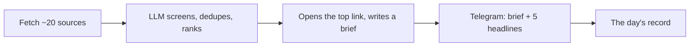

# Applied AI Dev Digest

**A daily digest of what's shipping in AI/ML, ranked for people who build with it, delivered to Telegram at noon.**

[](https://github.com/vickey-kapoor/Applied-AI-Dev-Digest/actions/workflows/ci.yml)
[](https://github.com/vickey-kapoor/Applied-AI-Dev-Digest/actions/workflows/daily-news.yml)
[](LICENSE)

The ranking question is *"what changes what I build this week?"*, not *"what matters most to the field?"* A callable model, a price change or a faster inference engine outranks a capability nobody can access yet.

Running daily since March 2026.

## How it works



Every run fetches the day's candidates, has an LLM screen, dedupe and rank them against nine topics, opens the top link to write a structured brief from the article itself, and sends the brief plus up to five headlines to Telegram. A noon-local scheduling guard and a KV claim make sure exactly one digest goes out per day, even when GitHub's scheduler fires late or twice.

**Sources:** lab blogs (OpenAI, DeepMind, Google AI/Research, Meta AI, Mistral, Qwen, Hugging Face, NVIDIA, Together AI) · scraped Anthropic news and the OpenAI changelog · GitHub releases of the main SDKs and inference engines · Hacker News (score > 100) · Hugging Face Daily Papers (20+ upvotes).

**Topics:** Model Releases · Product & API · Lab Research · Agents & Tooling · Benchmarks & Evals · Safety & System Cards · Open Weights · Compute & Infrastructure · Multimodal & Generative Media. Lab feeds pass unfiltered (venue is the signal); the open sources are keyword-filtered. Each item is tagged with the topic it fits *best*, scored over matched keywords, not the first that matches.

## Engineering notes

- **515 tests, no secrets in CI.** Every network and OpenAI call is mocked; CI runs `pytest` on every PR.
- **One job, nothing else.** The repo does exactly one thing: fetch, rank, summarize, send. A Next.js dashboard on Vercel for tuning topics, previewing and pausing was removed — nothing in the send path read it, and it was most of the upkeep.
- **Noon means noon.** GitHub's scheduled runs arrived anywhere from 30 minutes to 5 hours late. An hourly poll plus a hold-until-target guard, backed by an external `workflow_dispatch` at 12:01, pins delivery to the minute. Target time is evaluated in `America/Chicago`, so it survives DST.
- **Exactly-once sends.** A committed state file alone couldn't settle a race between a holding tick and a dispatch (it double-sent once). A KV claim that only one run can win closed that.
- **Model choice is a config knob.** Ranking and summary models are set independently; the current defaults replace `gpt-4o-mini` ahead of its shutdown, with a one-line rollback.
- **Cost:** well under a dollar a month.

## Run it yourself

```bash
git clone https://github.com/vickey-kapoor/Applied-AI-Dev-Digest.git
cd Applied-AI-Dev-Digest
python -m venv venv && source venv/bin/activate
pip install -r requirements.txt
cp .env.example .env     # add Telegram + OpenAI keys
python preview.py        # preview a digest without sending
python main.py           # run the full pipeline
pytest
```

Secrets, scheduling details and the repo layout are in [docs/OPERATIONS.md](docs/OPERATIONS.md).

## License

[MIT](LICENSE)
